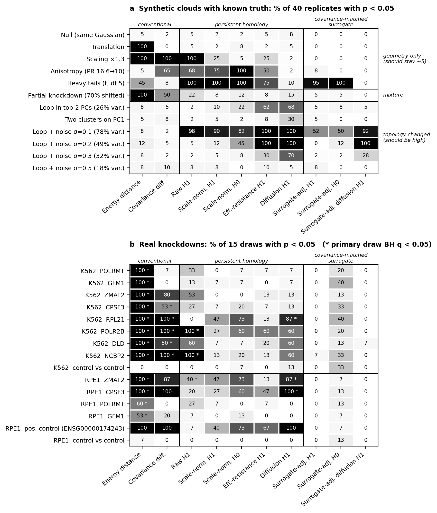

# TopoPerturb

**When does switching off a gene change the *shape* of a cell population, and when does it only move, grow or stretch it?**

We test whether persistent homology (a shape-detection method from topology) finds real shape changes after CRISPR gene knockdowns, or whether it is fooled by simple geometry. The data are the CausalBench K562 and RPE1 Perturb-seq datasets.

> **New here? Start with [`topoperturb_benchmark/`](topoperturb_benchmark/). It holds the final code and results.**
> The other folders are earlier steps, kept so that every result can be traced. Some of their conclusions were later corrected (see [Which results are current](#which-results-are-current)).

---

## Main result in three lines

1. Most early "shape" signals were **geometry**: the cell cloud got bigger (NCBP2, POLR2B) or more stretched (POLR2B, RPL21).
2. Ordinary Euclidean persistent homology **cannot see a real ring** at K562 noise levels with 150 cells. So "nothing found" was not proof of "nothing there".
3. **Diffusion-distance persistent homology** ignores moving, growing and stretching, and still finds rings in synthetic data. On real data it flags RPL21 (K562) and CPSF3 and ZMAT2 (RPE1). That is structure beyond simple geometry, but we cannot yet say it is a ring rather than a subgroup of cells.



*Panel a: synthetic clouds where the right answer is known. Panel b: the same tests on real knockdowns. Each number is the percent of tries where the test said "different" (p < 0.05).*

---

## Repository map

```
.
├── README.md                          ← you are here
├── requirements.txt                   ← Python packages (tested on Python 3.9)
│
├── topoperturb_benchmark/             ★ FINAL: code + results used for the poster
│   ├── topo_battery.py                  the 10 statistical tests (shared by both scripts below)
│   ├── prep_real.py                     builds the 30-PC K562 / RPE1 cell clouds
│   ├── synth_bench.py                   synthetic benchmark with known answers
│   ├── real_battery.py                  same 10 tests on the real knockdowns
│   ├── make_figures.py                  benchmark_heatmap.png
│   ├── concept_figure.py                simple "geometry vs topology" picture
│   ├── README.md                        details of the benchmark
│   └── outputs/                         tables (.csv), figures (.png), logs
│
├── earlier_phases/                    History: code for Steps 2–5 (results below)
│   ├── run_pilot.py                     Step 2   pilot: 8 genes, PCA, Mapper
│   ├── run_ph.py                        Step 3   first persistent homology test
│   ├── ph_common.py                     shared helpers for Phase 1 and 2 scripts
│   ├── perm2000.py                      Step 4   Phase 1.1: 2,000-permutation tests
│   ├── robust_grid.py                   Step 4   Phase 1.2: PCs x cells robustness grid
│   ├── interpret.py                     Step 4   Phase 1.3: what the H1 changes mean
│   ├── p2_ph.py                         Step 5   Phase 2.1/2.3: scale-normalized + spectral PH
│   ├── p2_conv.py                       Step 5   Phase 2.2: conventional statistics
│   ├── p2_rpe1.py                       Step 5   Phase 2.4: RPE1 validation
│   └── p2_surr_spectral.py              Step 5   Phase 2.5: Gaussian-surrogate check
│
├── CausalBench_K562_RPE1_Dataset_Audit.ipynb   Step 1  dataset audit
├── TopoPerturb_K562_Pilot_PCA_Mapper.ipynb     Step 2  original pilot notebook (run_pilot.py is the version that was run)
├── causalbench_perturbation_cell_counts.csv    Step 1 output: cells per knockdown
├── causalbench_shared_perturbations.csv        Step 1 output: genes knocked down in both cell lines
│
├── topoperturb_pilot_outputs/        output of run_pilot.py
├── topoperturb_ph_outputs/           output of run_ph.py
├── topoperturb_phase1_outputs/       output of perm2000.py, robust_grid.py, interpret.py
├── topoperturb_phase2_outputs/       output of the p2_*.py scripts
│
├── TopoPerturb — A Beginner's Report.pdf / .docx   plain-English report of everything (read this first)
├── TopoPerturb Report.pdf                            full technical progress report (Steps 1–5)
└── CausalBench_TopoPerturb_Research_Plan_No_Timeline.pdf   original research plan
```

---

## What each step did, in order

| Step | Question | Code | Output folder |
|---|---|---|---|
| 1. Audit | What is in the data? Cells, genes, labels, cells per knockdown | `CausalBench_K562_RPE1_Dataset_Audit.ipynb` | root `.csv` files |
| 2. Pilot | Pick 8 K562 genes; do PCA and Mapper show anything? | `earlier_phases/run_pilot.py` | `topoperturb_pilot_outputs/` |
| 3. First PH | Do persistence diagrams differ between control and knockdown (150 vs 150 cells)? | `earlier_phases/run_ph.py` | `topoperturb_ph_outputs/` |
| 4. Phase 1 | Do the differences survive 2,000 permutations and other PCA / cell-count settings? What do they mean? | `perm2000.py`, `robust_grid.py`, `interpret.py` | `topoperturb_phase1_outputs/` |
| 5. Phase 2 | Do they survive after removing cloud size? How do they compare with ordinary statistics, spectral distances, RPE1 and Gaussian copies? | `p2_ph.py`, `p2_conv.py`, `p2_rpe1.py`, `p2_surr_spectral.py` | `topoperturb_phase2_outputs/` |
| 6. Benchmark | Can each method find a real ring and ignore pure geometry, when the answer is known? | `topoperturb_benchmark/synth_bench.py` | `topoperturb_benchmark/outputs/` |
| 7. Real data | Same 10 tests on 8 K562 + 4 RPE1 knockdowns, with control-vs-control checks | `topoperturb_benchmark/real_battery.py` | `topoperturb_benchmark/outputs/` |

The 8 K562 genes: POLRMT, GFM1, ZMAT2, CPSF3, RPL21, POLR2B, DLD, NCBP2. The 4 RPE1 genes: ZMAT2, CPSF3, POLRMT, GFM1.

---

## Which results are current

| Claim | Where | Status |
|---|---|---|
| NCBP2 and POLR2B have robust H1 changes in all 12 settings | Phase 1 | **Explained by geometry.** Their clouds are 23% and 36% larger; the signal disappears after scale normalization |
| Scale-normalized Euclidean PH finds nothing in K562 or RPE1 | Phase 2 | **True, but not informative.** Step 6 shows this method cannot find a ring at this noise level |
| POLR2B and RPL21 residual signals | Phase 2 | **Explained by stretch** (participation ratio 10.0 and 10.8 vs 16.6 for controls) |
| "Gaussian copies reproduce the PH effects" | Phase 2.5 | **Weak evidence.** Step 6 shows the surrogate test has little power and gives false alarms on real cells |
| Sign-test q-values (e.g. q = 0.0002) | Phase 1.3 | **Replaced** by permutation q-values (the sign test over overlapping draws was anticonservative) |
| Diffusion H1 flags RPL21 (K562), CPSF3 and ZMAT2 (RPE1) | Step 7 | **Current.** Structure beyond geometry; ring vs cell subgroup still open |

---

## How to run

```bash
pip install -r requirements.txt
```

The first run downloads the data from Hugging Face and caches it as `.npz` files. These files are not in the repository.

**Final benchmark (Steps 6–7), about 1 hour on 8 CPU cores:**

```bash
cd topoperturb_benchmark
python prep_real.py
python synth_bench.py 40
python real_battery.py 15
python make_figures.py
```

**Earlier phases (Steps 2–5)** are run from the repository root, in this order:

```bash
python earlier_phases/run_pilot.py
python earlier_phases/run_ph.py
python earlier_phases/perm2000.py
python earlier_phases/robust_grid.py
python earlier_phases/interpret.py
python earlier_phases/p2_ph.py
python earlier_phases/p2_conv.py
python earlier_phases/p2_rpe1.py
python earlier_phases/p2_surr_spectral.py
```

Random seeds are fixed (seed 42), so reruns give the same numbers. Scripts use 4–8 processes; some take 10–30 minutes.

---

## Data

| Dataset | Cells | Genes | Link |
|---|---|---|---|
| CausalBench K562 | 162,751 | 622 | [huggingbahl21/causalbench-k562](https://huggingface.co/datasets/huggingbahl21/causalbench-k562) |
| CausalBench RPE1 | 162,733 | 383 | [huggingbahl21/causalbench-rpe1](https://huggingface.co/datasets/huggingbahl21/causalbench-rpe1) |

Values are already normalized and log-transformed. Labels: knocked-down gene ID, `non-targeting` (control) or `excluded` (dropped). The files have no guide or batch columns.

## Tools

NumPy, SciPy, pandas, scikit-learn (PCA, nearest neighbors), [ripser](https://github.com/scikit-tda/ripser.py) and [persim](https://github.com/scikit-tda/persim) (persistent homology and Wasserstein distance), [kepler-mapper](https://github.com/scikit-tda/kepler-mapper) (Mapper graphs), matplotlib.

## References

- Chevalley et al. CausalBench. [arXiv:2210.17283](https://arxiv.org/abs/2210.17283)
- Replogle et al. 2022. Genome-scale Perturb-seq. [Cell](https://doi.org/10.1016/j.cell.2022.05.013)
- Damrich, Berens & Kobak. Persistent homology for high-dimensional data based on spectral methods. NeurIPS 2024. [arXiv:2311.03087](https://arxiv.org/abs/2311.03087)
- Turkeš, Montúfar & Otter. On the effectiveness of persistent homology. NeurIPS 2022. [arXiv:2206.10551](https://arxiv.org/abs/2206.10551)

## Limitations

- Repeated draws reuse cells, so they show stability, not independent replication.
- No guide or batch metadata, so batch effects cannot be ruled out.
- 8 K562 and 4 RPE1 knockdowns so far; one diffusion setting (15 neighbors, t = 8).
